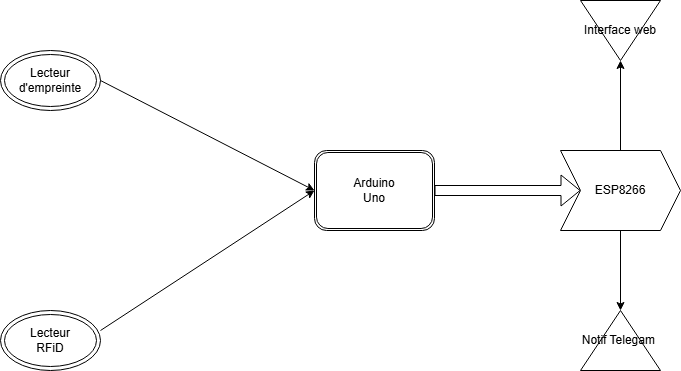
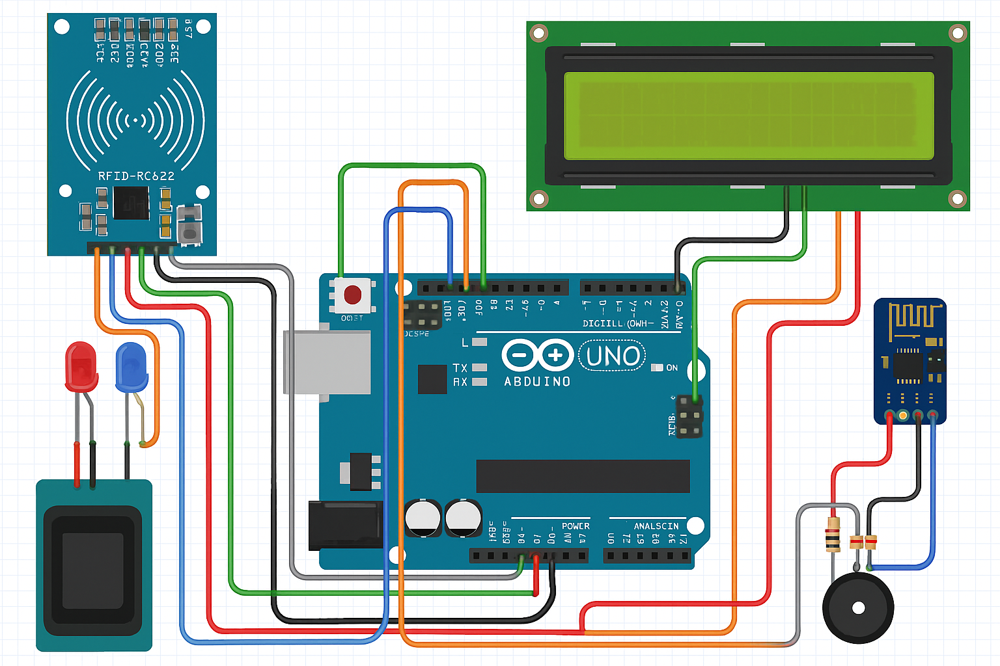

# Nomisys – Système de Contrôle d'Accès Sécurisé Multi-Facteurs

---

## 📜 Présentation du projet

Nomisys est un système de contrôle d’accès combinant plusieurs moyens d’authentification :
- Carte RFID (MFRC522)
- Capteur d’empreintes digitales (R307)
- Communication WiFi (ESP8266) pour dashboard web
- Notifications en temps réel via Telegram
- Écran LCD I2C pour interface utilisateur

Chaque tentative d’accès est journalisée en WiFi et affichée en local.

---

## 🛠️ Matériel Utilisé

| Composant                    | Quantité | Notes |
|:------------------------------|:---------|:------|
| Arduino Uno                   | 1        | Contrôleur principal |
| Module RFID MFRC522            | 1        | Lecture de cartes |
| Capteur d’empreintes digitales | 1        | Capteur UART |
| Module WiFi ESP8266            | 1        | Communication Web |
| Écran LCD 16x2 avec I2C        | 1        | Affichage |
| Buzzer              | 1        | Signaux sonores |
| LEDs           | 2      | Statut d'accès |
| Alimentation 5V               | 1        | (USB ou adaptateur) |

---

## ⚡ Schéma de Câblage

| Périphérique | Arduino Uno | Remarques |
|:-------------|:------------|:----------|
| MFRC522 SDA  | D10          | Slave Select SPI |
| MFRC522 SCK  | D13          | Clock SPI |
| MFRC522 MOSI | D11          | MOSI SPI |
| MFRC522 MISO | D12          | MISO SPI |
| MFRC522 RST  | D9           | Reset du module |
| MFRC522 3.3V | 3.3V         | Alimentation |
| MFRC522 GND  | GND          | Masse |
| Empreintes TX| D2           | RX Arduino |
| Empreintes RX| D3           | TX Arduino |
| Empreintes VCC| 5V          | Alimentation |
| Empreintes GND| GND         | Masse |
| LCD I2C SDA  | A4           | Bus I2C Data |
| LCD I2C SCL  | A5           | Bus I2C Clock |
| ESP8266 TX   | D7           | RX Arduino |
| ESP8266 RX   | D8           | TX Arduino (avec diviseur de tension 5V→3.3V) |
| ESP8266 VCC  | 3.3V         | Alimentation |
| ESP8266 GND  | GND          | Masse |

---
## 📚 Bibliothèques utilisées

| **Bibliothèque**           | **Description**                                                                  | **Utilisation**                                                                 |
|----------------------------|----------------------------------------------------------------------------------|----------------------------------------------------------------------------------|
| `SPI`                      | Permet la communication via le bus SPI.                                         | Utilisée pour la communication avec le module RFID MFRC522.                     |
| `MFRC522`                  | Bibliothèque pour les lecteurs RFID MFRC522.                                    | Utilisée pour lire les tags RFID.                                               |
| `Wire`                     | Permet la communication via le bus I2C.                                         | Utilisée pour la communication avec des périphériques I2C comme l'écran LCD.   |
| `LiquidCrystal_I2C`       | Contrôle les écrans LCD via I2C.                                                | Utilisée pour afficher des messages sur l'écran LCD I2C.                        |
| `Adafruit_Fingerprint`    | Bibliothèque pour les capteurs d'empreintes digitales Adafruit.                 | Utilisée pour interfacer le capteur d'empreintes digitales.                     |
| `SoftwareSerial`          | Permet la communication série sur d'autres broches numériques.                  | Utilisée pour la communication série avec l'ESP8266 ou d'autres périphériques. |
| `ESP8266WiFi`             | Bibliothèque Wi-Fi principale pour l'ESP8266.                                   | Utilisée pour connecter l'ESP8266 à un réseau Wi-Fi.                            |
| `ESP8266WebServer`        | Bibliothèque de serveur web simple pour ESP8266.                                | Utilisée pour héberger une interface web locale.                               |
| `WiFiClientSecure`        | Permet des connexions HTTPS via Wi-Fi sur ESP8266.                              | Utilisée pour des communications sécurisées (ex. envoi de messages Telegram).   |

---

## 🖍️ Schéma du Montage

---

## 🌐 Interface Web

Le ESP8266 héberge un mini serveur web :
- Affichage des logs d’accès
- Mise à jour en temps réel

Accès : `10.10.52.89`

---

## 🔔 Notifications Telegram

À chaque événement (accès autorisé/refusé), le système envoie :
- Un message Telegram

